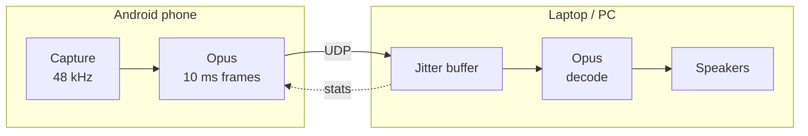

<p align="center">
  
</p>

<p align="center">
  <a href="https://github.com/adhidevara/airwire/releases/latest"></a>
  <a href="https://github.com/adhidevara/airwire/actions/workflows/ci.yml"></a>
  
  
  
  <a href="LICENSE"></a>
</p>

<p align="center">
  <b>Play your Android phone's audio on your PC, over your own Wi-Fi.</b><br>
  No cable, no cloud, no account.<br>
  <a href="README.id.md">Baca dalam Bahasa Indonesia</a>
</p>

---

Airwire captures what your phone is playing (or its microphone), compresses it with Opus,
and streams it over UDP to a small receiver on your laptop. Everything stays on your local
network.

## Features

- **Internal audio capture** on Android 10+ (YouTube, Spotify, games), with a microphone fallback.
- **Mute the phone, hear the PC.** Capture happens before the phone's volume is applied, so
  you can turn the phone down to zero (verified on HyperOS / Android 13).
- **Built for lossy Wi-Fi.** Every packet also carries the previous frame. Lost frames are
  rebuilt from that copy first, then from Opus in-band FEC, then with packet-loss concealment.
- **Adaptive jitter buffer.** It grows after an underrun, shrinks when the network is
  stable, and compensates for clock drift between the phone and the sound card.
- **Auto-discovery.** Tap *Auto Scan* and pick your PC, or type its IP.
- **Keeps streaming with the screen off.** Runs as a foreground service with a visible
  notification and a Stop button.
- **Light on resources.** About 3% of one CPU core and 50 MB of RAM on the receiver.
- **Bitrate from 64 to 192 kbps**, changed live from a slider.

## Screenshots

<p align="center">
  
</p>

## How it works



Each UDP packet carries the current frame plus a copy of the previous one. The receiver
fills gaps from that copy, then from Opus FEC, then with concealment, and sends loss and
jitter stats back to the phone.

The wire format is documented in [PROTOCOL.md](PROTOCOL.md). Both sides test against the
same byte vectors.

## Quick start

### 1. Receiver (Windows, Python 3.10+)

```bash
cd receiver
pip install -r requirements.txt
pip install -e .
python -m airwire
```

You can also double-click `receiver/Start Receiver.bat`. The window shows the PC's IP
address, the connected phone, latency, jitter, and packet loss, and lets you choose the
output device and volume.

> **Firewall:** allow Python on *Private* networks when Windows asks. If your Wi-Fi profile
> is *Public*, either switch it to Private or allow UDP 50005 inbound.

### 2. Android app

**Easiest:** download `Airwire-*.apk` from the [latest release](https://github.com/adhidevara/airwire/releases/latest),
open it on your phone, and allow "Install unknown apps".

**From source:**

1. Open the `android/` folder in Android Studio (tested with 2026.2.1). Gradle installs the
   NDK and CMake it needs automatically.
2. Connect your phone with USB debugging enabled and press **Run**.

Or build from a terminal:

```bash
cd android
./gradlew assembleDebug
adb install -r app/build/outputs/apk/debug/app-debug.apk
```

### 3. Stream

1. Put the phone and the PC on the same Wi-Fi network and start the receiver.
2. In the app, choose **Internal audio**, tap **Auto Scan Receiver**, then **START STREAMING**.
3. Accept Android's screen-capture prompt. Audio capture uses this permission, and Android
   asks again for every session.
4. Play something on the phone. It comes out of your PC.

## Latency

| Stage | Typical |
|---|---|
| Capture and Opus look-ahead (phone) | ~16 ms |
| Frame duration | 10 ms |
| Wi-Fi, one way | 1–10 ms |
| Jitter buffer (adaptive) | 10–40 ms |
| WASAPI shared-mode output | ~22 ms |

Measured end to end on loopback: **42 ms**. On a real network the jitter buffer adapts to
your Wi-Fi. A quiet 5 GHz network stays close to the loopback figure, while a busy 2.4 GHz
network can push the buffer above 100 ms. For the lowest latency, use 5 GHz and wired
speakers or headphones (Bluetooth adds 100–200 ms on its own).

## Test without a phone

`tools/fake_sender.py` speaks the same protocol as the app and can simulate a bad network:

```bash
cd receiver
python tools/fake_sender.py --discover                 # find receivers
python tools/fake_sender.py --loss 5 --jitter 15       # tone with 5% loss and 0-15 ms jitter
python tools/fake_sender.py --wav song_48k.wav --burst 3
python -m pytest                                       # 46 unit + integration tests
```

## Project layout

```
android/    Kotlin + Jetpack Compose app, libopus through JNI (NDK/CMake)
receiver/   Python receiver: Tkinter UI, jitter buffer, ctypes libopus binding, tests
assets/     Logo and banner
PROTOCOL.md UDP wire format shared by both sides
```

## FAQ

**Some apps come through silent.** Apps can opt out of playback capture (usually streaming
apps with DRM). Android enforces this; Airwire cannot override it.

**Can I stop the phone's speaker completely?** Turn the media volume down to zero.
Rerouting audio away from the speaker requires a system-only permission (`REMOTE_SUBMIX`).

**Phone calls?** Android does not allow capturing call audio.

**More than one phone?** The receiver locks onto one sender at a time. A second phone is
accepted once the first one stops.

## License

[MIT](LICENSE) © 2026 Ariel.

The Android build downloads [libopus](https://opus-codec.org) (BSD-3-Clause) at configure
time and verifies its SHA-256. On Windows the receiver uses the `opus.dll` shipped in the
[PyOgg](https://github.com/TeamPyOgg/PyOgg) wheel.
