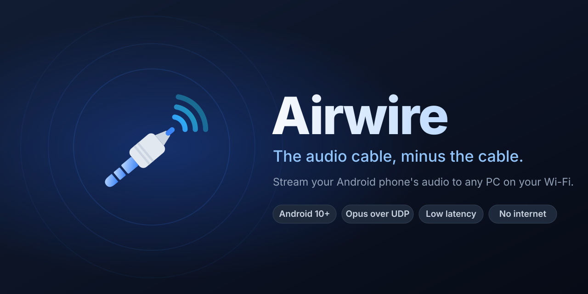
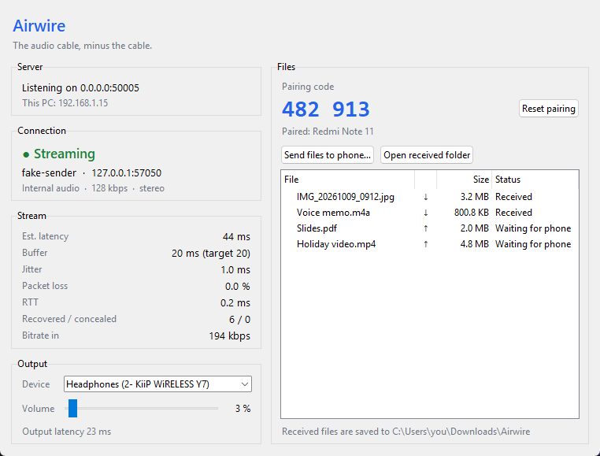
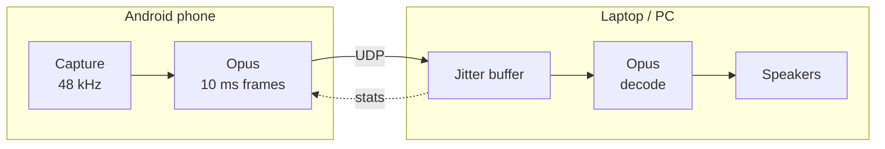

<p align="center">
  
</p>

<p align="center">
  <a href="https://github.com/adhidevara/airwire/releases/latest"></a>
  <a href="https://github.com/adhidevara/airwire/actions/workflows/ci.yml"></a>
  
  
  
  
  <a href="LICENSE"></a>
</p>

<p align="center">
  <b>Play your Android phone's audio on your PC, over your own Wi-Fi.</b><br>
  No cable, no cloud, no account.<br>
  <a href="README.id.md">Baca dalam Bahasa Indonesia</a>
</p>

---

Airwire captures what your phone is playing (or its microphone), compresses it with Opus,
and streams it over UDP to a small receiver on your laptop. Everything stays on your local
network.

## Features

- **Internal audio capture** on Android 10+ (YouTube, Spotify, games), with a microphone fallback.
- **Mute the phone, hear the PC.** Capture happens before the phone's volume is applied, so
  you can turn the phone down to zero (verified on HyperOS / Android 13).
- **Built for lossy Wi-Fi.** Every packet also carries the previous frame. Lost frames are
  rebuilt from that copy first, then from Opus in-band FEC, then with packet-loss concealment.
- **Adaptive jitter buffer.** Every frame records how long it waited before it was
  played. Latency is cut as soon as the last 10 s show it isn't needed, and held while
  the Wi-Fi keeps stalling, so it stays low without glitching. It also compensates for
  clock drift between the phone and the sound card.
- **Auto-discovery.** Tap *Auto Scan* and pick your PC, or type its IP.
- **Keeps streaming with the screen off.** Runs as a foreground service with a visible
  notification and a Stop button.
- **Light on resources.** About 3% of one CPU core and 50 MB of RAM on the receiver.
- **Bitrate from 64 to 192 kbps**, changed live from a slider.
- **File transfer, both ways.** Send photos, videos, and documents from the phone to the
  PC (or *Share → Airwire* from any app), and push files from the PC to the phone. Pair
  once with a 6-digit code; transfers are checked with SHA-256.
- **Play your PC on your phone, too.** Switch the app to *PC → Phone* and the phone plays
  what the PC is playing, like wireless headphones. It uses the same pairing, and only
  paired phones can ask for the PC's audio. Windows and Linux PCs.

## Screenshots

<p align="center">
  
</p>

## How it works



Each UDP packet carries the current frame plus a copy of the previous one. The receiver
fills gaps from that copy, then from Opus FEC, then with concealment, and sends loss and
jitter stats back to the phone.

The wire format is documented in [PROTOCOL.md](PROTOCOL.md). Both sides test against the
same byte vectors.

## Quick start

### 1. Receiver (Python 3.10+)

**Windows**

```bash
cd receiver
pip install -r requirements.txt
pip install -e .
python -m airwire
```

You can also double-click `receiver/Start Receiver.bat`. The window shows the PC's IP
address, the connected phone, latency, jitter, and packet loss, and lets you choose the
output device and volume.

> **Firewall:** allow Python on *Private* networks when Windows asks. If your Wi-Fi profile
> is *Public*, either switch it to Private or allow port 50005 inbound (UDP for audio, TCP
> for files).

**macOS** (tested on Ventura). Homebrew's Python ships without Tkinter and does not allow
system-wide `pip install`, so install `python-tk` and use a virtual environment:

```bash
brew install python python-tk opus
cd receiver
python3 -m venv .venv
source .venv/bin/activate
pip install -r requirements.txt
pip install -e .
python -m airwire
```

After that, double-click `receiver/Start Receiver.command`; it uses `receiver/.venv`
automatically. When macOS asks whether Python may accept incoming network connections,
click **Allow**.

### 2. Android app

**Easiest:** download `Airwire-*.apk` from the [latest release](https://github.com/adhidevara/airwire/releases/latest),
open it on your phone, and allow "Install unknown apps".

**From source:**

1. Open the `android/` folder in Android Studio (tested with 2026.2.1). Gradle installs the
   NDK and CMake it needs automatically.
2. Connect your phone with USB debugging enabled and press **Run**.

Or build from a terminal:

```bash
cd android
./gradlew assembleDebug
adb install -r app/build/outputs/apk/debug/app-debug.apk
```

### 3. Stream

1. Put the phone and the PC on the same Wi-Fi network and start the receiver.
2. In the app, choose **Internal audio**, tap **Auto Scan Receiver**, then **START STREAMING**.
3. Accept Android's screen-capture prompt. Audio capture uses this permission, and Android
   asks again for every session.
4. Play something on the phone. It comes out of your PC.

### 4. Send files

1. In the app, open the **Files** tab and enter the 6-digit pairing code shown in the
   receiver window. You only do this once per phone.
2. **Phone → PC:** tap **Send files to PC**, or share files from any app and pick
   **Airwire**. They are saved to `Downloads\Airwire` on the PC.
3. **PC → phone:** in the receiver window click **Send files to phone…**. The phone
   downloads them while Airwire is open or streaming and saves them to `Download/Airwire`.

### 5. Play the PC's audio on the phone

1. Pair once in the **Files** tab (see above).
2. In the **Audio** tab choose **PC → Phone** and tap **START LISTENING**.
3. The receiver window shows which phones are listening under *Play this PC on your
   phone*. **Stop** ends it; unticking the box turns the feature off.

The PC captures its system audio with the `soundcard` package (WASAPI loopback on Windows,
PulseAudio or PipeWire on Linux). macOS can't capture system audio without a virtual
device such as BlackHole, so this direction isn't supported there yet.

## Latency

| Stage | Typical |
|---|---|
| Capture and Opus look-ahead (phone) | ~16 ms |
| Frame duration | 10 ms |
| Wi-Fi, one way | 1–10 ms |
| Jitter buffer (adaptive) | 10–30 ms |
| WASAPI shared-mode output | ~22 ms |

Estimated end to end on loopback: **about 45 ms**, with a 20 ms buffer. On a real network
the buffer follows your Wi-Fi: it keeps enough to ride out the stalls of the last 10 s and
gives the rest back. A quiet 5 GHz network stays close to the loopback figure; a busy
2.4 GHz network needs more. Packets are marked as real-time traffic (DSCP EF), which Wi-Fi
routers with WMM send ahead of downloads. For the lowest latency, use 5 GHz and wired
speakers or headphones (Bluetooth adds 100–200 ms on its own).

`tools/fake_sender.py --chunk 2 --stall 60 --stall-every 4` reproduces a bursty phone and
a stalling network on one PC.

## Test without a phone

`tools/fake_sender.py` speaks the same protocol as the app and can simulate a bad network:

```bash
cd receiver
python tools/fake_sender.py --discover                 # find receivers
python tools/fake_sender.py --loss 5 --jitter 15       # tone with 5% loss and 0-15 ms jitter
python tools/fake_sender.py --wav song_48k.wav --burst 3
python tools/fake_listener.py --host 127.0.0.1 --code 123456   # listen to this PC
python -m pytest                                       # 79 unit + integration tests
```

## Project layout

```
android/    Kotlin + Jetpack Compose app, libopus through JNI (NDK/CMake)
receiver/   Python receiver: Tkinter UI, jitter buffer, ctypes libopus binding, tests
assets/     Logo and banner
PROTOCOL.md Wire formats: UDP audio and the HTTP file API
```

## FAQ

**Some apps come through silent.** Apps can opt out of playback capture (usually streaming
apps with DRM). Android enforces this; Airwire cannot override it.

**Can I stop the phone's speaker completely?** Turn the media volume down to zero.
Rerouting audio away from the speaker requires a system-only permission (`REMOTE_SUBMIX`).

**Phone calls?** Android does not allow capturing call audio.

**More than one phone?** The receiver locks onto one sender at a time. A second phone is
accepted once the first one stops.

**Can someone else on my Wi-Fi listen to my PC?** Not without pairing. A phone has to
prove it holds a pairing token with every request (HMAC), and the receiver window lists
every phone that is listening. The audio itself is not encrypted, like the rest of
Airwire's traffic.

**Is file transfer encrypted?** No. Files travel as plain HTTP on your local network, and
only paired phones can send or receive them. Use it on networks you trust, not on public
Wi-Fi. *Reset pairing* in the receiver window revokes every phone at once.

## Contributors

- [Muhammad Hasief](https://github.com/hantungoprek): macOS receiver support.

## License

[MIT](LICENSE) © 2026 Ariel.

The Android build downloads [libopus](https://opus-codec.org) (BSD-3-Clause) at configure
time and verifies its SHA-256. On Windows the receiver uses the `opus.dll` shipped in the
[PyOgg](https://github.com/TeamPyOgg/PyOgg) wheel; on macOS it uses Homebrew's libopus.
